# Illustrator Studio MCP

**Adobe Illustratorの作業を、AIに安全に、確かめながら頼めます。**

作図から修正、結果の確認、入稿データの準備まで、AIアプリに頼んで進められます。

   [](https://www.npmjs.com/package/illustrator-studio-mcp) [](LICENSE)

[English](README.md) | **日本語**

Claude Desktop · ChatGPT Work · Claude Code · Codex CLI

[96の機能](docs/tools.md) · 適用の前に計画 · 結果を読み直して確認

<!-- demo-video:start -->
https://github.com/user-attachments/assets/f23a3ad7-65e8-424b-b779-803152c61e2d

*デザイナーの実務で使える機能を紹介する、2分55秒のプロモーション動画です。画面はイメージで、Illustratorの実際の画面ではありません。*
<!-- demo-video:end -->

## 計画 → 適用 → 検証

言葉で頼めます。たとえば:

- 「選択した見出しを『週末限定フェア』に変えて。文字サイズと色はそのままで」
- 「この3つの図形を、横に等間隔で並べて」
- 「この写真を最新版の画像に差し替えて。位置と大きさはそのままで」

1. **計画** — 変える前に、対象と変更内容を見せます。あなたが確かめてから適用します。
2. **適用** — 書き込む直前にも対象を確かめます。計画の後で誰かが変えていたら、上書きせずに止まります。
3. **検証** — 書き込んだ後はIllustratorから結果を読み直します。応答が途切れて結果が分からないときは、次の編集を止めます。推測で続けません。見た目や入稿品質は、最後にIllustratorの画面で確認してください。

いまはPublic Beta（0.1.0-beta.6）です。[Illustrator 2026（30.8）で操作ごとに実機確認](docs/compatibility.md)しています。

## Adobe公式のIllustrator MCP（Beta）との違い

AdobeのIllustrator（Beta）には、MCPサーバーが内蔵されています。Illustrator Studio MCPは、通常版のIllustrator（Mac）向けの独立したプロジェクトです。対象にしているIllustratorの版、扱える範囲、変更の確かめ方が違います。

| | Adobe内蔵のMCP | Illustrator Studio MCP |
|---|---|---|
| Illustratorの版 | Illustrator（Beta） | 通常版のIllustrator 2026（30.8で確認。Betaは確認していません） |
| OS | ヘルプにmacOSとWindowsの手順あり | Mac専用 |
| 範囲と数 | ツールと操作（ヘルプの記載では40）：ドキュメントとアートボード、オブジェクトの確認、レイヤーとグループ、選択と変形、簡単なテキスト編集と見た目の変更、PNG・JPEG・SVG・PDFの書き出し | ツール一覧の機能：図形とテキストの作成、テキストやフォントのまとめて変更、色、バーコードとQRコード、日本語の改行チェック、印刷前チェック、PDFと画像の書き出し、バックアップ。数え方が異なるため、数ではなく範囲で比べてください |
| 変更の確認 | AIツールが提案された変更の承認・拒否を尋ねる。取り消しはIllustratorでCommand + Z（macOS）／Ctrl + Z（Windows） | まず対象と変更内容を計画として見せ、書き込む直前にもう一度対象を確かめる |
| 結果の確認 | ヘルプには記載なし | Illustratorから結果を読み直す。結果が分からないときは次の編集を止める |
| 手で直した箇所 | ヘルプには記載なし | 上書きせずに止まる |
| 印刷 | PDF・PNG・JPEG・SVGで書き出し | 印刷前チェック、トンボと塗り足しつきのPDF、PDF/Xの明示指定とファイルにPDF/Xの記載があるかの確認（PDF/X準拠の判定ではありません） |
| 日本語の組版 | ヘルプには記載なし | 改行チェック、フォントの組み合わせの置き換え |

「記載なし」は、ヘルプがどちらとも述べていないという意味で、機能がないという意味ではありません。Adobe側の列は、Adobeのヘルプ3ページ（[概要](https://helpx.adobe.com/illustrator/desktop/connect-with-other-apps-and-tools/about-using-ai-tools-with-illustrator.html)、[接続](https://helpx.adobe.com/illustrator/desktop/connect-with-other-apps-and-tools/connect-illustrator-to-ai-tools.html)、[ドキュメントの操作](https://helpx.adobe.com/illustrator/desktop/connect-with-other-apps-and-tools/work-with-illustrator-documents-from-ai-tools.html)）の内容で、Adobeの最終更新は2026年8月18日、確認は2026年10月1日です。Betaの内容は変わる可能性があります。お使いのIllustratorの版と作業に合うほうをお選びください。

## インストール

### Mac CLI（npm / npx）

MacとNode.js 20以上を用意し、通常版Illustratorを前面に表示・ロック解除して、確認用の書類を開きます。次の2行で版とdoctorを確認します。手動download・clone・build・global installは不要です。

```bash
npx -y illustrator-studio-mcp@beta --version
npx -y illustrator-studio-mcp@0.1.0-beta.6 doctor
```

`@beta` はdiscovery用、保存する登録は確認したexact versionです。表示がbeta.6以外なら止まり、その版の案内を確認します。Node/npm/npxのPATHとregistry失敗時の案内、明示更新・rollbackは[導入ガイド](docs/install.md)にあります。読み取り専用の `setup` で、起動した版に固定した登録コマンドも表示できます。空cacheでのversion起動は既存Macの測定で、新品Mac・doctor・client再接続の完了を意味しません。

### Claude Desktop（いちばん簡単・Node.js不要）

1. [illustrator-studio-mcp-0.1.0-beta.6.mcpb をダウンロード](https://github.com/mhimt-lab/illustrator-studio-mcp/releases/download/v0.1.0-beta.6/illustrator-studio-mcp-0.1.0-beta.6.mcpb)して、ダブルクリック →「インストール」を押します。
2. 拡張が有効になっていることを確かめて、新しいチャットで使い始めます。

ダウンロードしたファイルを確かめたい場合は、[GitHubの配布ページ](https://github.com/mhimt-lab/illustrator-studio-mcp/releases/tag/v0.1.0-beta.6)の `SHA256SUMS` と照合できます（手順は[導入ガイド](docs/install.md#desktop拡張mcpb主な手順)）。

### ChatGPT

必要なもの: Node.js 20以上（[公式サイト](https://nodejs.org/ja)のインストーラーで入れます）

1. ChatGPTのサイドバーで「プラグイン」を開き、右上の「追加」→「マーケットプレイスを追加」を選びます。
2. 「ソース」に `mhimt-lab/illustrator-studio-mcp`、「Git ref」に `v0.1.0-beta.6` を入力し、「マーケットプレイスを追加」を押します。Git ref は版の固定です。
3. 同じ画面で「Illustrator」を検索し、Illustrator Studio MCP の「＋」を押します。「インストールしました」と表示されれば完了です。
4. 上の「Work」を選び、入力欄の右下のパソコンのアイコンが「お使いのコンピューターで」になっていることを確かめて、新しいチャットで使い始めます。

削除は、「プラグイン」で Illustrator Studio MCP の「…」→「アンインストール」です。ChatGPTのモデルによっては、ツールを探さずに失敗することがあります。うまくいかないときは、上位のモデルで試してください。実行場所の「クラウドで」には対応していません。

ターミナルに慣れている方は、Codex CLIのコマンド2行でも追加できます（追加後はChatGPTを起動し直します）。

```bash
codex plugin marketplace add mhimt-lab/illustrator-studio-mcp --ref v0.1.0-beta.6
codex plugin add illustrator-studio-mcp@illustrator-studio-mcp
```

### Claude Code

Node.js 20以上が必要です。ターミナルで次の1行を実行し、Claude Codeを起動し直します。

```bash
claude mcp add --transport stdio --scope user illustrator-studio -- npx -y illustrator-studio-mcp@0.1.0-beta.6
```

### Codex CLI

Node.js 20以上が必要です。ターミナルで次の1行を実行し、Codex CLIを起動し直します。

```bash
codex mcp add illustrator-studio -- npx -y illustrator-studio-mcp@0.1.0-beta.6
```

ダウンロードしたファイルの確かめ方、更新・削除、ほかの登録方法は[導入ガイド](docs/install.md)にまとめています。

## 機能

主な機能です。画像はプロモーション動画から切り出したイメージで、Illustratorの実際の画面ではありません。条件は機能ごとに違うので、それぞれのリンク先を確認してください。

<table>
<tr>
<td width="33%" valign="top"><br><b>話しかけるだけでIllustratorで作図</b><br>作りたいものを言葉で伝えると、AIがIllustratorで図形や文字をまとめて作ります。作ったものは一つずつIllustratorから読み直して確かめます。<br><a href="docs/tools.md#図形と文字をつくる">条件 →</a></td>
<td width="33%" valign="top"><br><b>修正をまとめて一度に</b><br>クライアントの修正リストのような複数の変更を、1回でまとめて反映します。途中で失敗したら、ほかの変更も元に戻します。<br><a href="docs/tools.md#文字をまとめて差し替える">条件 →</a></td>
<td width="33%" valign="top"><br><b>日本語の組版を点検し、分割禁止で直す</b><br>Illustratorが組んだ実際の改行位置を読み、禁則や、分けたくない語の泣き別れを指摘します（文書は変えません）。見つけた語には分割禁止を設定できます。<br><a href="docs/tools.md#日本語の改行を点検する">条件 →</a></td>
</tr>
<tr>
<td width="33%" valign="top"><br><b>写真を枠いっぱいに配置して切り抜く</b><br>写真で枠を覆うように配置し、見せたいところ（カップなど）が収まる位置に合わせます。はみ出した部分は矩形のクリッピングマスクで切り抜きます。<br><a href="docs/tools.md#写真を枠に合わせて配置する">条件 →</a></td>
<td width="33%" valign="top">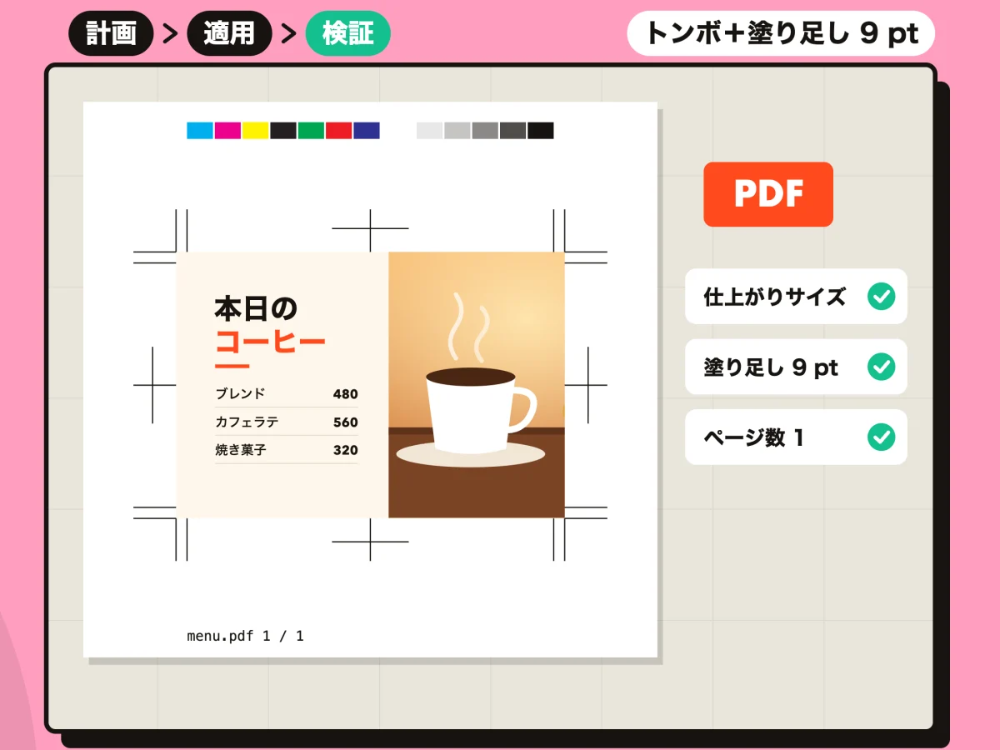<br><b>トンボつきの入稿PDFを書き出す</b><br>トンボ・カラーバー・ページ情報と塗り足しを付けたPDFを新しいファイルに書き出し、仕上がりサイズと塗り足しを確かめます。元のファイルは変えません。文書の中に編集できるトンボを作ることもできます。<br><a href="docs/tools.md#塗り足しとトンボつきのpdf">条件 →</a></td>
<td width="33%" valign="top"><br><b>Illustratorで手を入れても、AIが上書きしない</b><br>頼んだ後に自分で直した所があれば、AIは書き込む前に止まって確認します。上書き保存の前には、検証済みのバックアップを取ります。<br><a href="docs/safety.md">安全の仕組み →</a></td>
</tr>
</table>

## できること

<table>
<tr>
<td width="33%" valign="top"><sub>文字</sub><br><b><a href="docs/tools.md#文字の一部を差し替えて書式を変える">文字の差し替えと書式の変更</a></b></td>
<td width="33%" valign="top"><sub>文字</sub><br><b><a href="docs/tools.md#縦組みに切り替える">横組みと縦組みを切り替え</a></b></td>
<td width="33%" valign="top">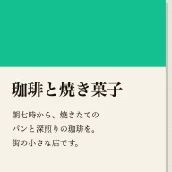<sub>文字</sub><br><b><a href="docs/tools.md#フォントの組をまとめて置き換える">フォントをまとめて置き換え</a></b></td>
</tr>
<tr>
<td width="33%" valign="top">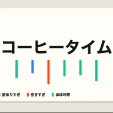<sub>文字</sub><br><b><a href="docs/tools.md#見出しの字間を分析する">見出しの字間を分析</a></b></td>
<td width="33%" valign="top">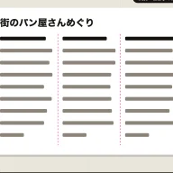<sub>文字</sub><br><b><a href="docs/tools.md#エリア内文字を段組みにする">エリア内文字を段組みに</a></b></td>
<td width="33%" valign="top"><sub>文字</sub><br><b><a href="docs/tools.md#すべての文字を抜き出して校正する">すべての文字を抜き出して校正</a></b></td>
</tr>
<tr>
<td width="33%" valign="top">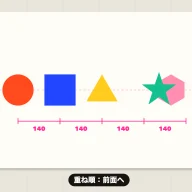<sub>配置</sub><br><b><a href="docs/tools.md#整列と等間隔">整列・等間隔・重ね順</a></b></td>
<td width="33%" valign="top">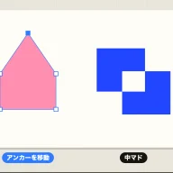<sub>パス</sub><br><b><a href="docs/tools.md#パスの編集とパスファインダー">パスの編集とパスファインダー</a></b></td>
<td width="33%" valign="top"><sub>パス</sub><br><b><a href="docs/tools.md#破線と線端と角の形">破線・線端・角の形</a></b></td>
</tr>
<tr>
<td width="33%" valign="top">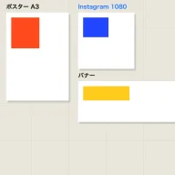<sub>書類</sub><br><b><a href="docs/tools.md#アートボードとレイヤーを整理する">アートボードとレイヤーを整理</a></b></td>
<td width="33%" valign="top">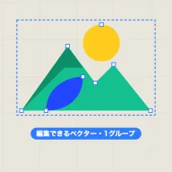<sub>書類</sub><br><b><a href="docs/tools.md#svgやaiを取り込む">SVG・AIを取り込む</a></b></td>
<td width="33%" valign="top">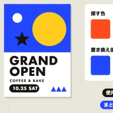<sub>色</sub><br><b><a href="docs/tools.md#色を探して置き換える">色を探して置き換え</a></b></td>
</tr>
<tr>
<td width="33%" valign="top">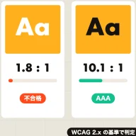<sub>色</sub><br><b><a href="docs/tools.md#文字と背景のコントラストを判定する">文字と背景のコントラスト</a></b></td>
<td width="33%" valign="top">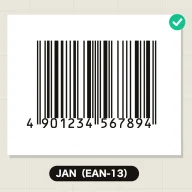<sub>コード</sub><br><b><a href="docs/tools.md#janコードをつくる">JANコードとQRコード</a></b></td>
<td width="33%" valign="top">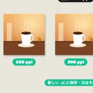<sub>画像</sub><br><b><a href="docs/tools.md#画像の解像度を確かめて軽くする">画像の解像度をチェック・軽量化</a></b></td>
</tr>
<tr>
<td width="33%" valign="top">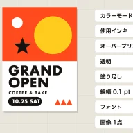<sub>入稿</sub><br><b><a href="docs/tools.md#印刷前にチェックする">入稿前のチェック</a></b></td>
<td width="33%" valign="top">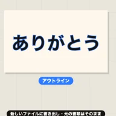<sub>書き出し</sub><br><b><a href="docs/tools.md#文字をアウトライン化して書き出す">アウトライン化と画像の書き出し</a></b></td>
<td width="33%" valign="top">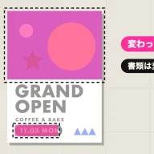<sub>確認</sub><br><b><a href="docs/tools.md#変わった所を画像で比べる">変わった所を画像で比べる</a></b></td>
</tr>
</table>

小さな画像も、同じプロモーション動画から切り出したものです。すべての機能は[ツール一覧](docs/tools.md)、頼み方の例は[使い方と依頼例](docs/usage.md)にあります。

## 使うときの注意

- **Mac専用です。** 通常版のAdobe Illustrator（2026・30.8で確認）で使います。
- **Windowsは準備中です。** WindowsとIllustratorをお持ちの方に、検証への協力をお願いしています。手順と検証キットは[Windows検証キット](https://github.com/mhimt-lab/illustrator-studio-mcp/blob/main/windows-probe/README.md)にあります（結果は公開のIssueで提出していただきます）。
- **Illustratorを前面に表示し、画面をロックしないでください。** 背面や画面ロック中は、操作が止まったり、理由の分かりにくい失敗になったりします。
- **まず制作ファイルのコピーで試してください。** 試用版で、本番運用向けの完成版ではありません。

## 最初の頼み方

Illustratorで確認用の書類を開き、まずは見るだけの依頼をします。MacがIllustratorの操作許可を求めた場合は、内容を確認して許可します。

```text
Illustratorで開いている書類と、いま選択している文字や図形を教えて。
確認するだけにして、変更・保存・書き出しはしないで。
```

返答がIllustratorの画面と合っていれば準備完了です。何も選択していない場合は「選択なし」で正常です。

次に、変更案だけを見せてもらいます。グループに入っていない一行の文字（文字ツールでクリックして入力した文字）を選んでから、こう頼みます。

```text
選択した見出しを「週末限定フェア」に変えたい。文字サイズと色はそのままにして。
まず対象と変更案を見せて。まだ変更・保存はしないで。
対応できない書式なら、その理由を教えて。
```

対象と内容に間違いがなければ、「その内容で変更して」と頼みます。ほかの依頼の例は[使い方と依頼例](docs/usage.md)にあります。

## 詳しい情報

- [使い方と依頼例](docs/usage.md) — できることの一覧と、そのまま使える依頼文
- [導入ガイド](docs/install.md) — アプリ別の登録手順、更新・削除
- [対応範囲と検証記録](docs/compatibility.md) — Betaの範囲、アプリ別の確認状況、既知の制約
- [安全の仕組み](docs/safety.md) — 変更を確かめる流れ、上書き保存・バックアップ
- [困ったとき](docs/runbook.md) — 応答が止まった・結果が分からないとき
- [ツール一覧](docs/tools.md) — AIアプリが使う機能の一覧
- [変更履歴](CHANGELOG.md)・[リリースノート](RELEASE_NOTES.md) — 版ごとの変更
- [サポート](SUPPORT.ja.md)・[セキュリティ](SECURITY.ja.md) — 不具合の報告と脆弱性の連絡
- [English README](README.md) — 英語版

## ライセンス

[Business Source License 1.1](LICENSE)です。通常の社内業務や、クライアントにデザイン成果物を納める制作利用はAdditional Use Grantで許可されています。第三者へ競合する製品・サービスとして提供する場合は制限があります。OSI準拠のオープンソースライセンスではありません。利用条件は[LICENSE本文](LICENSE)を確認してください。

Illustrator Studio MCPは独立したプロジェクトで、Adobeの公式製品ではありません。Adobeによる提携・承認・後援はありません。QRコードは株式会社デンソーウェーブの登録商標です。Adobe、IllustratorはAdobeの米国およびその他の国における商標または登録商標です。

<details>
<summary>接続・開発担当者向け：機能の識別名（普段の依頼では入力不要）</summary>

`illustrator_align_objects`, `illustrator_analyze_display_spacing`, `illustrator_apply_character_style`, `illustrator_apply_pathfinder`, `illustrator_audit_typography`, `illustrator_capture_preview`, `illustrator_capture_structure_snapshot`, `illustrator_check_contrast`, `illustrator_check_text_consistency`, `illustrator_close_document`, `illustrator_close_edit_session`, `illustrator_compare_images`, `illustrator_create_area_text`, `illustrator_create_backup`, `illustrator_create_barcode`, `illustrator_create_batch`, `illustrator_create_character_style`, `illustrator_create_clipping_mask`, `illustrator_create_document`, `illustrator_create_layer`, `illustrator_create_point_text`, `illustrator_create_qr_code`, `illustrator_create_rectangle`, `illustrator_create_shape`, `illustrator_create_swatch_resource`, `illustrator_create_trim_marks`, `illustrator_delete_objects`, `illustrator_diff_structure`, `illustrator_duplicate_object`, `illustrator_edit_path_points`, `illustrator_embed_image`, `illustrator_export`, `illustrator_export_outlined`, `illustrator_export_pdf`, `illustrator_extract_design_tokens`, `illustrator_extract_text`, `illustrator_find_color_usages`, `illustrator_find_fonts`, `illustrator_get_area_text_options`, `illustrator_get_context`, `illustrator_get_edit_session`, `illustrator_get_object`, `illustrator_get_path_points`, `illustrator_group_objects`, `illustrator_import_vector_artwork`, `illustrator_list_documents`, `illustrator_list_layers`, `illustrator_list_objects`, `illustrator_list_recipes`, `illustrator_list_selection`, `illustrator_list_swatches`, `illustrator_list_text_styles`, `illustrator_make_compound_path`, `illustrator_move_object_to_layer`, `illustrator_mutate_batch`, `illustrator_open_document`, `illustrator_open_edit_session`, `illustrator_optimize_images`, `illustrator_place_image`, `illustrator_plan_color_replacement`, `illustrator_plan_recipe`, `illustrator_preflight_images`, `illustrator_preflight_print`, `illustrator_read_structure_diff`, `illustrator_reconcile`, `illustrator_reconcile_backup`, `illustrator_reconcile_delete`, `illustrator_reconcile_export`, `illustrator_reconcile_save_as`, `illustrator_release_clipping_mask`, `illustrator_relink_image`, `illustrator_render_artboards`, `illustrator_reorder_layer`, `illustrator_replace_area_text_range`, `illustrator_replace_font`, `illustrator_replace_point_text`, `illustrator_replace_point_text_batch`, `illustrator_replace_text_range`, `illustrator_run_m6_appearance_preview_recipe`, `illustrator_run_recipe`, `illustrator_save_document`, `illustrator_save_document_as`, `illustrator_save_recipe`, `illustrator_set_area_text_columns`, `illustrator_set_layer_state`, `illustrator_set_no_break`, `illustrator_set_object_state`, `illustrator_set_path_appearance`, `illustrator_set_stacking_order`, `illustrator_set_stroke_style`, `illustrator_set_text_orientation`, `illustrator_set_text_style`, `illustrator_transform_object`, `illustrator_transform_path_anchors`, `illustrator_update_artboard`, `illustrator_update_character_style`

</details>

## 連絡先

公開用の管理者名は **mhimt**、連絡先は [sporks-framer9t@icloud.com](mailto:sporks-framer9t@icloud.com) です。応答時間の保証はありません。脆弱性や私的な資料を通常のIssueに投稿せず、[非公開の脆弱性報告](https://github.com/mhimt-lab/illustrator-studio-mcp/security/advisories/new)、または機密情報を含めない概要のメールを使ってください。
