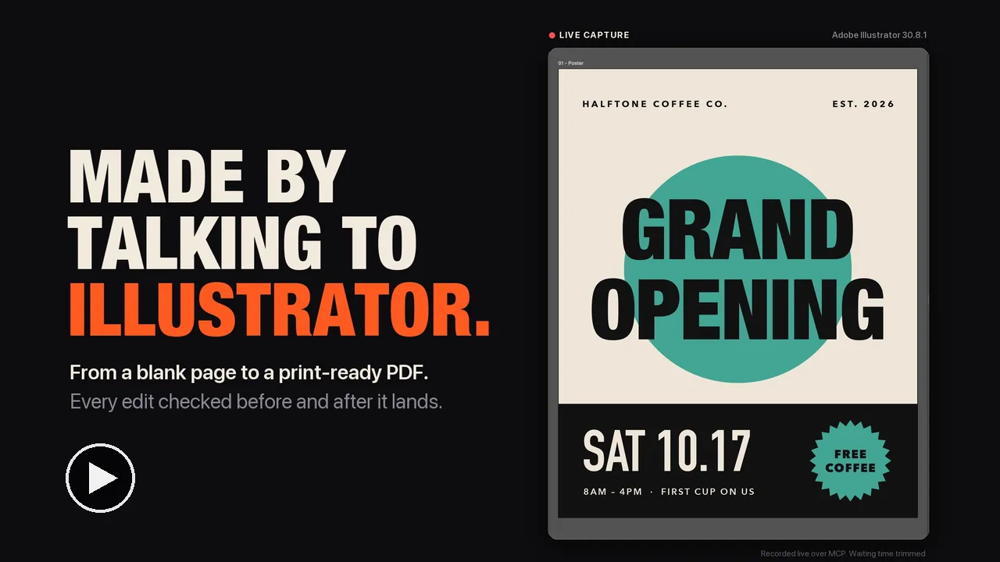
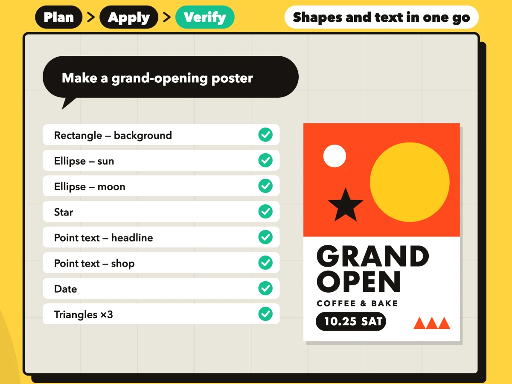
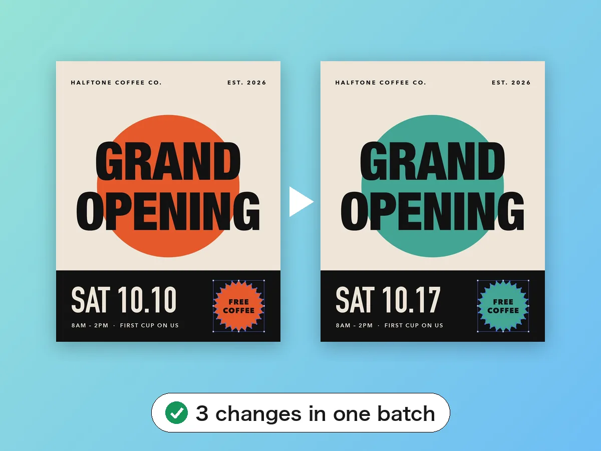
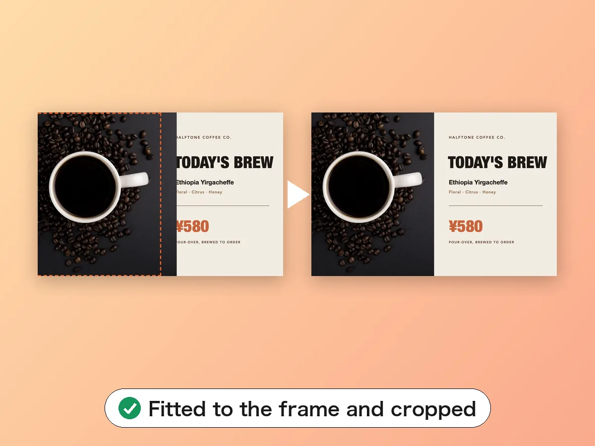
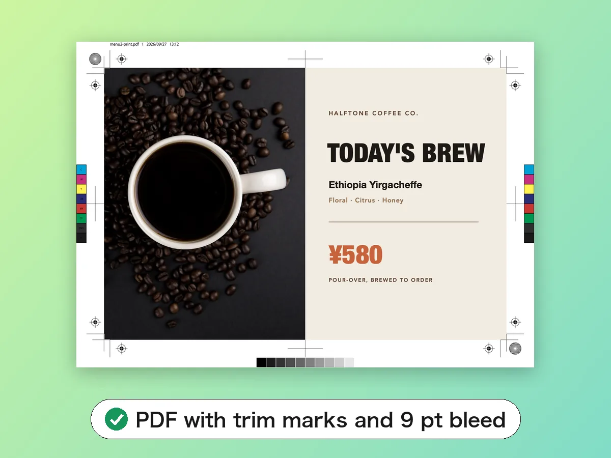
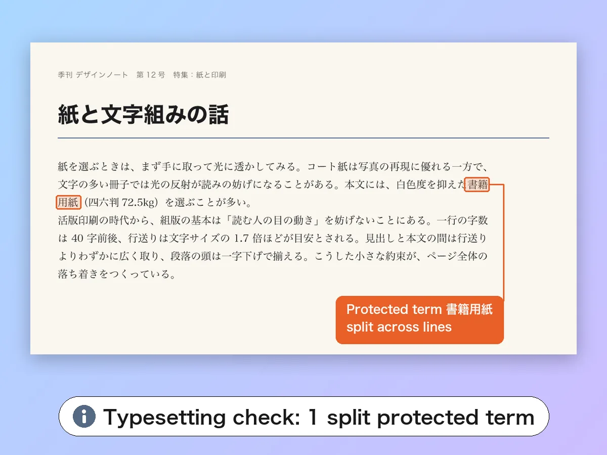
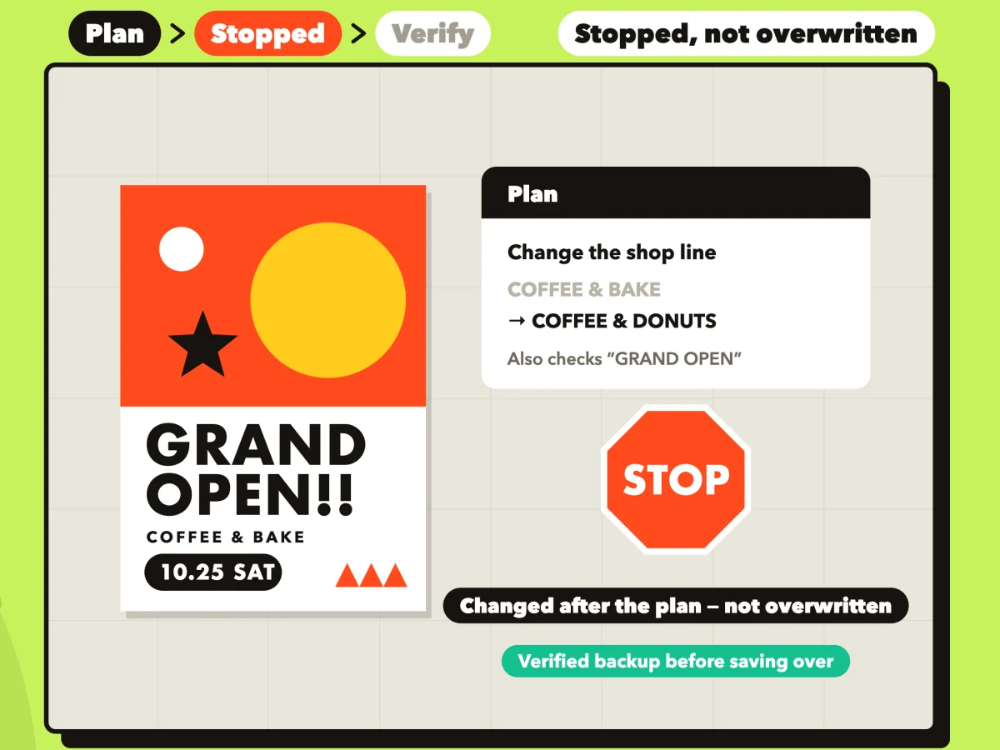
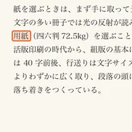
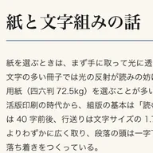

# Illustrator Studio MCP

**Ask AI to work in Adobe Illustrator — safely and verifiably.**

Create, revise, verify, and prepare artwork for print — by asking your AI app.

   [](https://www.npmjs.com/package/illustrator-studio-mcp) [](LICENSE)

**English** | [日本語](README.ja.md)

Claude Desktop · ChatGPT Work · Claude Code · Codex CLI

[88 functions](docs/tools.en.md) · Plan before apply · Read-back verification

<!-- demo-video:start -->
<!-- npm: [](https://github.com/user-attachments/assets/08701dd6-7016-4915-8fb7-811602866b34) -->

https://github.com/user-attachments/assets/08701dd6-7016-4915-8fb7-811602866b34

*65-second demo recorded live over MCP in the real Illustrator 30.8.1 (waiting time trimmed): it builds a poster, applies a client’s changes in one go, stops instead of overwriting a line you touched up by hand after asking, and exports a print-ready PDF. The touch-up after asking was staged for the demo.*
<!-- demo-video:end -->

## Plan → Apply → Verify

Ask in plain words. For example:

- “Change the selected headline to ‘Weekend Special’. Keep its size and color.”
- “Space these three shapes evenly in a row.”
- “Swap this photo for the latest version. Keep its position and size.”

1. **Plan** — before changing anything, it shows the target and the proposed change. You check it before it is applied.
2. **Apply** — it checks the target again immediately before writing. If someone changed it after the plan, it stops instead of overwriting.
3. **Verify** — it reads the result back from Illustrator. If a response is lost and the outcome is unclear, it stops further edits instead of guessing. Check the final look and print readiness in Illustrator yourself.

This is a Public Beta (0.1.0-beta.5), [checked operation by operation on Illustrator 2026 (30.8)](docs/compatibility.en.md).

## How it differs from Adobe's Illustrator MCP (Beta)

Adobe's Illustrator (Beta) has a built-in MCP server. Illustrator Studio MCP is a separate, independent project for stable Illustrator on Mac. They differ in the Illustrator version they target, what they cover, and how a change is checked.

| | Adobe's built-in MCP | Illustrator Studio MCP |
|---|---|---|
| Illustrator version | Illustrator (Beta) | Stable Illustrator 2026, checked on 30.8 (Beta is not checked) |
| OS | The Help pages describe steps for macOS and Windows | Mac only |
| Scope and count | Tools and actions (the Help lists 40): documents and artboards, inspecting objects, layers and groups, selecting and transforming, simple text edits and appearance, export as PNG, JPEG, SVG or PDF | 88 functions: creating shapes and text, batch text and font changes, Japanese line-break check, print check, PDF export, backups. Counting methods differ, so compare coverage rather than numbers |
| Reviewing a change | Your AI tool asks you to accept or reject the suggested changes; undo in Illustrator with Command + Z (macOS) or Ctrl + Z (Windows) | Shows the target and change as a plan first, and checks the target again right before writing |
| Checking the result | Not described in the Help pages | Reads the result back from Illustrator; stops further edits if the outcome is unclear |
| Edits you made by hand | Not described in the Help pages | Stops instead of overwriting |
| Print | Export as PDF, PNG, JPEG or SVG | Print check, PDF with trim marks and bleed |
| Japanese typesetting | Not described in the Help pages | Line-break check; replacing font pairs |

“Not described” means the Help pages do not say either way. It does not mean the feature is absent. The Adobe column reflects three Adobe Help pages ([About](https://helpx.adobe.com/illustrator/desktop/connect-with-other-apps-and-tools/about-using-ai-tools-with-illustrator.html), [Connect](https://helpx.adobe.com/illustrator/desktop/connect-with-other-apps-and-tools/connect-illustrator-to-ai-tools.html), [Work with documents](https://helpx.adobe.com/illustrator/desktop/connect-with-other-apps-and-tools/work-with-illustrator-documents-from-ai-tools.html)), last updated by Adobe on Aug 18, 2026 and read on Oct 1, 2026. The Beta may change. Choose the one that fits your Illustrator version and your work.

## Install

### Claude Desktop (easiest, no Node.js needed)

1. [Download illustrator-studio-mcp-0.1.0-beta.5.mcpb](https://github.com/mhimt-lab/illustrator-studio-mcp/releases/download/v0.1.0-beta.5/illustrator-studio-mcp-0.1.0-beta.5.mcpb), double-click it, then click Install.
2. Check that the extension is enabled, then start using it in a new chat.

To check the downloaded file, compare it with `SHA256SUMS` on the [GitHub release page](https://github.com/mhimt-lab/illustrator-studio-mcp/releases/tag/v0.1.0-beta.5) (steps in [Install](docs/install.en.md#desktop-extension-mcpb-main-method)).

### ChatGPT

You need: Node.js 20 or newer (install it with the installer from the [official website](https://nodejs.org/))

1. In the ChatGPT sidebar, open Plugins, then choose Add (top right) → Add a marketplace.
2. Enter `mhimt-lab/illustrator-studio-mcp` as the Source and `v0.1.0-beta.5` as the Git ref, then click Add marketplace. The Git ref pins the version.
3. On the same screen, search for "Illustrator" and click the "+" next to Illustrator Studio MCP. It is done when "plugin installed" appears.
4. Choose Work at the top, check that the computer icon at the lower right of the message box is set to On your computer, then start using it in a new chat.

To remove it, choose "…" → Uninstall on Illustrator Studio MCP under Plugins. Some ChatGPT models may fail without looking for the tools. If it does not work, try a more capable model. Running "In the cloud" is not supported.

If you are comfortable with Terminal, you can also add it with two Codex CLI commands (restart ChatGPT afterwards):

```bash
codex plugin marketplace add mhimt-lab/illustrator-studio-mcp --ref v0.1.0-beta.5
codex plugin add illustrator-studio-mcp@illustrator-studio-mcp
```

### Claude Code

Requires Node.js 20 or newer. Run this in Terminal, then restart Claude Code:

```bash
claude mcp add --transport stdio illustrator-studio -- npx -y illustrator-studio-mcp@beta
```

### Codex CLI

Requires Node.js 20 or newer. Run this in Terminal, then restart Codex CLI:

```bash
codex mcp add illustrator-studio -- npx -y illustrator-studio-mcp@beta
```

For checking the download, updating, uninstalling, and other ways to register, see [Install](docs/install.en.md).

## Features

The main things it does. Every picture is real artwork: cards 1, 2 and 6 are from the demo recorded in the real Illustrator 30.8.1 (in card 6, the manual change between plan and apply was staged for the demo), and cards 3–5 were made and exported with this server in the real Illustrator 30.8.2. In card 5, the body text was set to justified by a one-off script before the check, because this server cannot change paragraph alignment yet. The photo is a CC0 (public domain) photo from Wikimedia Commons.

<table>
<tr>
<td width="33%" valign="top"><br><b>Design in Illustrator by just asking</b><br>Describe what you want, and the AI builds the shapes and text in Illustrator. Each object is read back from Illustrator to check it.<br><a href="docs/usage.en.md">Usage →</a></td>
<td width="33%" valign="top"><br><b>Apply a round of changes at once</b><br>Apply several changes, like a client’s revision list, in one go. If one step fails, the others are rolled back.<br><a href="docs/usage.en.md">Usage →</a></td>
<td width="33%" valign="top"><br><b>Fill a frame with a photo and crop it</b><br>Place a photo so it covers the frame, with the part you want to show (like the cup) kept in view. A rectangular clipping mask crops what spills over.<br><a href="docs/tools.en.md#fit-a-photo-to-a-frame">Conditions →</a></td>
</tr>
<tr>
<td width="33%" valign="top"><br><b>Export a print PDF with trim marks</b><br>Writes a new PDF with trim marks, color bars, page information and bleed (9 pt here), then checks its trim size and bleed. The original file is not changed.<br><a href="docs/tools.en.md#pdf-with-bleed-and-trim-marks">Conditions →</a></td>
<td width="33%" valign="top"><br><b>Check Japanese typesetting, swap fonts in one go</b><br>Reads the line breaks Illustrator actually set and points out kinsoku breaks and protected terms split across lines, without changing the document. Several font pairs, like body and headings, can be replaced in one go.<br><a href="docs/tools.en.md#check-japanese-line-breaks">Conditions →</a></td>
<td width="33%" valign="top"><br><b>Your manual edits are safe</b><br>If you touched up the artwork after asking, the AI stops before writing and checks with you. The same goes for changes by another script or plug-in.<br><a href="docs/safety.en.md">Safety →</a></td>
</tr>
</table>

## What you can do

<table>
<tr>
<td width="33%" valign="top"><sub>Design</sub><br><b><a href="docs/tools.en.md#create-shapes-and-text">Create shapes and text by asking</a></b></td>
<td width="33%" valign="top"><sub>Text</sub><br><b><a href="docs/tools.en.md#replace-text-in-one-go">Update headlines and dates in one go</a></b></td>
<td width="33%" valign="top"><sub>Text</sub><br><b><a href="docs/tools.en.md#check-japanese-line-breaks">Check Japanese line breaks</a></b></td>
</tr>
<tr>
<td width="33%" valign="top"><sub>Text</sub><br><b><a href="docs/tools.en.md#replace-several-fonts-at-once">Replace several fonts at once</a></b></td>
<td width="33%" valign="top"><sub>Images</sub><br><b><a href="docs/tools.en.md#fit-a-photo-to-a-frame">Fill a frame with a photo</a></b></td>
<td width="33%" valign="top"><sub>Images</sub><br><b><a href="docs/tools.en.md#crop-a-photo">Crop a photo to its frame</a></b></td>
</tr>
<tr>
<td width="33%" valign="top"><sub>Print</sub><br><b><a href="docs/tools.en.md#check-before-printing">Check before printing</a></b></td>
<td width="33%" valign="top"><sub>Print</sub><br><b><a href="docs/tools.en.md#pdf-with-bleed-and-trim-marks">PDF with trim marks and bleed</a></b></td>
<td width="33%" valign="top"><sub>Print</sub><br><b><a href="docs/tools.en.md#add-trim-marks-to-the-document">Add trim marks to the document</a></b></td>
</tr>
<tr>
<td width="33%" valign="top"><sub>Print</sub><br><b><a href="docs/tools.en.md#export-with-outlined-text">Export with outlined text</a></b></td>
<td width="33%" valign="top"><sub>Safety</sub><br><b><a href="docs/tools.en.md#keep-your-manual-edits">Keep your manual edits</a></b></td>
<td width="33%" valign="top"><sub>Safety</sub><br><b><a href="docs/tools.en.md#back-up-before-saving-over">Back up before saving over</a></b></td>
</tr>
</table>

The small pictures are cropped from the artwork above and from other files made and exported with this server. Conditions differ by operation. See all functions in the [tool catalog](docs/tools.en.md) and requests to try in [Usage and examples](docs/usage.en.md).

## Before you use it

- **Mac only.** Use it with stable Adobe Illustrator (checked with Illustrator 2026, version 30.8).
- **Windows support is in preparation.** If you have Windows and Illustrator, we are looking for collaborators to help verify it. The steps and the kit are in the [Windows verification kit](https://github.com/mhimt-lab/illustrator-studio-mcp/blob/main/windows-probe/README.en.md) (results are submitted through a public issue).
- **Keep Illustrator in the foreground and the screen unlocked.** In the background or with the screen locked, operations stop or fail with an unclear reason.
- **Try it on a copy of your artwork first.** This is a trial release, not production-ready.

## Your first requests

Open a test document in Illustrator and start with a request that only looks. If macOS asks permission to control Illustrator, review and allow it.

```text
Tell me which documents are open in Illustrator and which text or shapes are selected.
Only look. Do not change, save, or export anything.
```

If the answer matches what you see in Illustrator, you are ready. “No selection” is correct when nothing is selected.

Next, ask to see a proposed edit only. Select one line of text outside a group (text you created by clicking with the Type tool), then ask:

```text
I'd like to change the selected headline to “Weekend Special”, keeping its size and color.
Show me what you would change and where. Do not change or save anything yet.
If its formatting is unsupported, tell me why.
```

If the target and text are right, ask it to go ahead with that change. See [Usage and examples](docs/usage.en.md) for more requests.

## More information

- [Usage and examples](docs/usage.en.md) — everything you can ask for, and requests to copy
- [Install](docs/install.en.md) — setup for each AI app, updating and uninstalling
- [Compatibility and verification](docs/compatibility.en.md) — Beta scope, per-app verification, known limitations
- [Safety](docs/safety.en.md) — how each change is checked, saving over and backups
- [Recovery](docs/runbook.en.md) — when a response stops or the outcome is unclear
- [Tool catalog](docs/tools.en.md) — the functions your AI app uses
- [Changelog](CHANGELOG.en.md) and [release notes](RELEASE_NOTES.en.md) — changes in each version
- [Support](SUPPORT.md) and [Security](SECURITY.md) — reporting bugs and vulnerabilities
- [日本語のREADME](README.ja.md) — Japanese version

## License

[Business Source License 1.1](LICENSE). The Additional Use Grant permits ordinary internal business use and design services where clients receive creative outputs. Providing a Competitive Offering to third parties is restricted. This is not an OSI-approved open source license. Read the full [LICENSE](LICENSE) for its terms.

Illustrator Studio MCP is an independent project, not an Adobe product. It is not affiliated with, endorsed by, or sponsored by Adobe. Adobe and Illustrator are either registered trademarks or trademarks of Adobe in the United States and/or other countries.

<details>
<summary>Connection reference: tool identifiers (not needed for everyday requests)</summary>

`illustrator_align_objects`, `illustrator_apply_character_style`, `illustrator_apply_pathfinder`, `illustrator_audit_typography`, `illustrator_capture_preview`, `illustrator_capture_structure_snapshot`, `illustrator_check_contrast`, `illustrator_check_text_consistency`, `illustrator_close_document`, `illustrator_close_edit_session`, `illustrator_compare_images`, `illustrator_create_area_text`, `illustrator_create_backup`, `illustrator_create_batch`, `illustrator_create_character_style`, `illustrator_create_clipping_mask`, `illustrator_create_document`, `illustrator_create_layer`, `illustrator_create_point_text`, `illustrator_create_rectangle`, `illustrator_create_shape`, `illustrator_create_swatch_resource`, `illustrator_create_trim_marks`, `illustrator_delete_objects`, `illustrator_diff_structure`, `illustrator_duplicate_object`, `illustrator_edit_path_points`, `illustrator_embed_image`, `illustrator_export`, `illustrator_export_outlined`, `illustrator_export_pdf`, `illustrator_extract_design_tokens`, `illustrator_find_color_usages`, `illustrator_find_fonts`, `illustrator_get_area_text_options`, `illustrator_get_context`, `illustrator_get_edit_session`, `illustrator_get_object`, `illustrator_get_path_points`, `illustrator_group_objects`, `illustrator_import_vector_artwork`, `illustrator_list_documents`, `illustrator_list_layers`, `illustrator_list_objects`, `illustrator_list_recipes`, `illustrator_list_selection`, `illustrator_list_swatches`, `illustrator_list_text_styles`, `illustrator_make_compound_path`, `illustrator_move_object_to_layer`, `illustrator_mutate_batch`, `illustrator_open_document`, `illustrator_open_edit_session`, `illustrator_optimize_images`, `illustrator_place_image`, `illustrator_plan_color_replacement`, `illustrator_plan_recipe`, `illustrator_preflight_images`, `illustrator_preflight_print`, `illustrator_read_structure_diff`, `illustrator_reconcile`, `illustrator_reconcile_backup`, `illustrator_reconcile_delete`, `illustrator_reconcile_export`, `illustrator_reconcile_save_as`, `illustrator_release_clipping_mask`, `illustrator_relink_image`, `illustrator_reorder_layer`, `illustrator_replace_font`, `illustrator_replace_point_text`, `illustrator_replace_point_text_batch`, `illustrator_replace_text_range`, `illustrator_run_m6_appearance_preview_recipe`, `illustrator_run_recipe`, `illustrator_save_document`, `illustrator_save_document_as`, `illustrator_save_recipe`, `illustrator_set_area_text_columns`, `illustrator_set_layer_state`, `illustrator_set_no_break`, `illustrator_set_object_state`, `illustrator_set_path_appearance`, `illustrator_set_stacking_order`, `illustrator_set_text_orientation`, `illustrator_set_text_style`, `illustrator_transform_object`, `illustrator_update_artboard`, `illustrator_update_character_style`

</details>

## Contact

The approved maintainer identity is **mhimt**, with contact [sporks-framer9t@icloud.com](mailto:sporks-framer9t@icloud.com). There is no guaranteed response time. Keep vulnerabilities and private materials out of ordinary Issues; use [private vulnerability reporting](https://github.com/mhimt-lab/illustrator-studio-mcp/security/advisories/new), or send a redacted initial summary by email.
